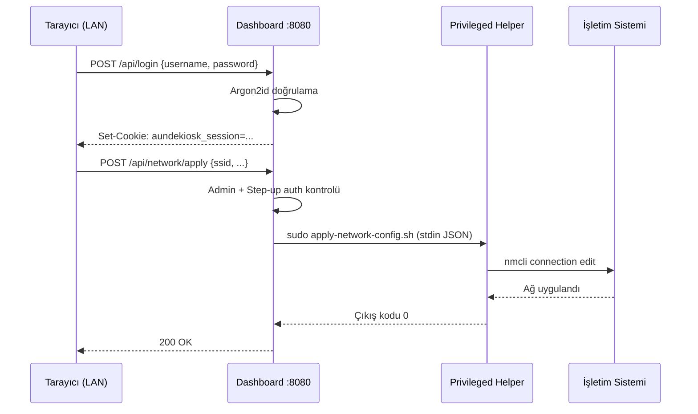

# AundeKiosk — Kurulum ve Kullanım Kılavuzu

**AundeKiosk**, Raspberry Pi 4/5 üzerinde çalışan, fabrika ortamları için geliştirilmiş bir kiosk yönetim sistemidir. Açılışta Chromium'u tam ekran kiosk modunda başlatır; yapılandırılmış URL'leri otomatik olarak döndürür ve güvenli bir web dashboard'u üzerinden uzaktan yönetim sağlar.

---

## İçindekiler

1. [Sistem Mimarisi](#1-sistem-mimarisi)
2. [Gereksinimler](#2-gereksinimler)
3. [İşletim Sistemi Hazırlığı](#3-i̇şletim-sistemi-hazırlığı)
4. [Kurulum](#4-kurulum)
5. [İlk Çalıştırma — Dashboard Kurulum Sihirbazı](#5-i̇lk-çalıştırma--dashboard-kurulum-sihirbazı)
6. [Dashboard Kullanımı](#6-dashboard-kullanımı)
7. [Güncelleme](#7-güncelleme)
8. [Kurtarma Modu](#8-kurtarma-modu)
9. [Güvenlik Notları](#9-güvenlik-notları)
10. [Sorun Giderme](#10-sorun-giderme)

---

## 1. Sistem Mimarisi

AundeKiosk üç bağımsız katmanda çalışır: kiosk ekranı, dashboard ve privileged helper'lar. Her katman kendi kullanıcı hesabı altında koşarak saldırı yüzeyini sınırlar.

```
┌─────────────────────────────────────────────────────────────────┐
│                       Raspberry Pi 4/5                          │
│                                                                 │
│  ┌─────────────────┐     ┌──────────────────────────────────┐  │
│  │  Kiosk Ekranı   │     │     Dashboard — HTTPS :8080      │  │
│  │  (pi kullanıcı) │     │     (aundekiosk kullanıcısı)     │  │
│  │                 │     │                                  │  │
│  │  Chromium       │     │  ┌──────────┐  ┌─────────────┐  │  │
│  │  --kiosk modu   │     │  │ Auth &   │  │ Kiosk URL   │  │  │
│  │                 │     │  │ Oturum   │  │ Yönetimi    │  │  │
│  │  Dönen URL'ler: │     │  └──────────┘  └─────────────┘  │  │
│  │  ┌────────────┐ │     │  ┌──────────┐  ┌─────────────┐  │  │
│  │  │  URL 1     │ │     │  │ Terminal │  │  VNC        │  │  │
│  │  │  URL 2     │ │     │  │ Proxy    │  │  Proxy      │  │  │
│  │  │  ...       │ │     │  └────┬─────┘  └──────┬──────┘  │  │
│  └─────────────────┘     └───────┼───────────────┼──────────┘  │
│                                  │               │             │
│  ┌───────────────────────────────┴───┐  ┌────────┴──────────┐  │
│  │  PTY Server — :7681 (iç)         │  │  wayvnc — :5900   │  │
│  │  (root kullanıcısı)              │  │  (iç)             │  │
│  │  /bin/bash -l (root shell)       │  │  Wayland ekran    │  │
│  └───────────────────────────────────┘  └───────────────────┘  │
│                                                                 │
│  ┌─────────────────────────────────────────────────────────┐   │
│  │  Privileged Helpers (root, sudoers whitelist)           │   │
│  │  apply-network-config.sh  toggle-ssh.sh                │   │
│  │  change-os-password.sh    configure-snmp.sh            │   │
│  │  reboot-device.sh         change-hostname.sh           │   │
│  └─────────────────────────────────────────────────────────┘   │
└─────────────────────────────────────────────────────────────────┘
          ▲
          │  HTTPS :8080 (LAN)
          │
   Tarayıcı (IT ekibi)
```

### Veri Akışı



---

## 2. Gereksinimler

### Donanım

| Bileşen | Minimum | Önerilen |
|---------|---------|----------|
| Model | Raspberry Pi 3B+ (64-bit OS) | **Raspberry Pi 4** (2GB+) |
| RAM | 1 GB | 4 GB |
| SD Kart | 16 GB Class 10 | 32 GB A1/A2 |
| Ağ | Ethernet veya WiFi | **Ethernet** (kararlılık için) |
| Ekran | HDMI destekli | — |

> **Önemli:** Pi 1, Pi 2 ve orijinal Pi Zero desteklenmez (32-bit mimari).
> Pi 3/4/5 ve Zero 2 W'de **64-bit Raspberry Pi OS imajı** zorunludur.

### Yazılım (otomatik kurulur)

- Deno (TypeScript runtime)
- Chromium
- wayvnc (Wayland ekran yakalama)
- noVNC (tarayıcı tabanlı VNC istemcisi)
- jq, wtype/xdotool, openssl, snmpd, iptables

---

## 3. İşletim Sistemi Hazırlığı

### Adım 1 — Raspberry Pi Imager ile SD Kart Hazırla

1. [Raspberry Pi Imager](https://www.raspberrypi.com/software/) indir ve çalıştır.
2. **İşletim sistemi** seç: `Raspberry Pi OS (other)` → `Raspberry Pi OS Lite (64-bit)`
   - GUI gerekmez; Wayland compositor (labwc) AundeKiosk tarafından başlatılır.
   - **64-bit imajı seçmek zorunludur** — 32-bit imajda dashboard başlamaz.
3. **Depolama** olarak hedef SD kartı seç.
4. Dişli simgesine tıkla → **Gelişmiş Ayarlar**:

| Ayar | Değer |
|------|-------|
| Hostname | `kiosk-01` (veya istediğin isim) |
| SSH'ı Etkinleştir | **Evet** — Parola ile kimlik doğrulama |
| Kullanıcı Adı | `pi` |
| Parola | Güçlü bir parola belirle |
| WiFi | Gerekiyorsa yapılandır |
| Locale | Gerektiği gibi ayarla |

5. **Yaz** butonuna tıkla ve işlemin tamamlanmasını bekle.

### Adım 2 — Pi'ye SSH ile Bağlan

SD kartı Pi'ye tak, güç ver ve yaklaşık 60 saniye bekle:

```bash
ssh pi@<pi-ip-adresi>
```

Pi'nin IP adresini öğrenmek için: router arayüzüne bak veya `nmap -sn 192.168.x.0/24` komutunu çalıştır.

### Adım 3 — Sistemi Güncelle

```bash
sudo apt update && sudo apt upgrade -y
sudo reboot
```

Reboot sonrası tekrar SSH ile bağlan.

---

## 4. Kurulum

### Kurulum Akışı

```
git clone → install.sh → Servisler başlar → Dashboard hazır
    │              │
    ▼              ▼
/opt/aundekiosk   Bağımlılıklar kurulur (deno, chromium, ...)
                  Sistem kullanıcısı oluşturulur (aundekiosk)
                  TLS sertifikası üretilir (self-signed)
                  systemd servisleri kurulur ve başlatılır
```

### Adım 1 — Repoyu Klon Et

```bash
sudo git clone https://github.com/turgaypek/aundekiosk.git /opt/aundekiosk
```

> Kurulum dizini **`/opt/aundekiosk`** olmalıdır — bu yol servis dosyalarına sabit kodlanmıştır.

### Adım 2 — Kurulum Scriptini Çalıştır

```bash
cd /opt/aundekiosk
sudo bash scripts/setup/install.sh
```

Kurulum şu işlemleri otomatik yapar:

| Adım | Açıklama |
|------|----------|
| Mimari kontrolü | 32-bit ARM tespitinde anlaşılır hata ile durur |
| Bağımlılık kurulumu | jq, chromium, wtype, xdotool, deno, snmpd, novnc, ... |
| `aundekiosk` sistem kullanıcısı | Dashboard'u çalıştıran ayrıcalıksız kullanıcı |
| wayvnc yapılandırması | localhost'a bağlanır, auth olmadan (dashboard katmanı yönetir) |
| TLS sertifikası | Self-signed; `tls/` dizinine yazılır |
| Deno bağımlılıkları | Önbelleklenir; servis internete erişmez |
| sudoers whitelist | Privileged helper'lar için dar kapsamlı NOPASSWD izinleri |
| Chromium RAM cache | SD kart aşınmasını önlemek için tmpfs |
| systemd servisleri | Kurulur, etkinleştirilir ve başlatılır |

Kurulum tamamlandığında aşağıdaki çıktıyı görürsün:

```
✔ AundeKiosk is now installed.
  Dashboard: https://192.168.x.x:8080/
⚠ The TLS certificate is self-signed — your browser will warn about it once; this is expected.
⚠ Kiosk mode will launch on the next startup.
```

### Adım 3 — Kiosk Modunu Başlat

```bash
sudo reboot
```

Reboot sonrası Pi, kiosk modunda otomatik olarak başlar. Ekrana bağlı monitörde Chromium tam ekran açılır.

---

## 5. İlk Çalıştırma — Dashboard Kurulum Sihirbazı

Tarayıcından dashboard'a eriş:

```
https://<pi-ip-adresi>:8080
```

> **Self-signed TLS uyarısı:** Tarayıcı bir güvenlik uyarısı gösterir. "Gelişmiş" → "Devam et (güvensiz)" seçeneğine tıkla. Bu uyarı sadece bir kez ve sadece kendi ağındaki bu cihaz için geçerlidir.

### İlk Kullanıcı Oluşturma

Dashboard, ilk açılışta bir kurulum sihirbazı gösterir — **varsayılan kullanıcı adı/parola yoktur.**

```
┌─────────────────────────────────────┐
│       AundeKiosk İlk Kurulum        │
│                                     │
│  Kullanıcı Adı: [__________________]│
│  Parola:        [__________________]│
│  Parola Tekrar: [__________________]│
│                                     │
│         [ Hesabı Oluştur ]          │
└─────────────────────────────────────┘
```

- Kullanıcı adı: küçük harf, harf ve rakam, 3–32 karakter
- Parola: en az 12 karakter, güçlü bir parola seç
- Bu hesap **`admin`** rolüyle oluşturulur

Hesap oluşturulduktan sonra otomatik olarak giriş yapılır ve dashboard ana sayfasına yönlendirilirsin.

---

## 6. Dashboard Kullanımı

Dashboard'da iki kullanıcı rolü vardır:

| Rol | Yetkiler |
|-----|----------|
| **admin** | Tüm özellikler: yapılandırma, SSH, ağ, terminal, VNC, kullanıcı yönetimi |
| **viewer** | Sadece okuma: kiosk URL'lerini ve sistem durumunu görüntüleme |

---

### 6.1 Kiosk URL Yapılandırması

Dashboard ana sayfasında kiosk'ta gösterilecek URL listesini yönetirsin.

```
┌─────────────────────────────────────────────────────┐
│  Kiosk URL'leri                                     │
│                                                     │
│  URL                      Süre    Döngü            │
│  ┌────────────────────┐  [10] s  [10] ×  [Sil]    │
│  │ https://site1.com  │                            │
│  └────────────────────┘                            │
│  ┌────────────────────┐  [15] s  [ 5] ×  [Sil]    │
│  │ https://site2.com  │                            │
│  └────────────────────┘                            │
│                                                     │
│  [ + URL Ekle ]           [ Kaydet ve Uygula ]      │
└─────────────────────────────────────────────────────┘
```

| Alan | Açıklama |
|------|----------|
| **URL** | Gösterilecek sayfa (`http://` veya `https://`) |
| **Süre** | Bu URL'de kaç saniye kalınacak |
| **Döngü** | Kaç kez gösterildikten sonra bir sonrakine geçilecek |

Kaydet butonuna tıklandığında kiosk ekranı anında yeni URL'e geçer.

---

### 6.2 Sistem Durumu

Sistem durumu sayfası Pi'nin anlık kaynak kullanımını gösterir:

```
┌──────────────────────────────────────────────────┐
│  Sistem Durumu                                   │
│                                                  │
│  CPU:    ████████░░░░  65%                       │
│  RAM:    ██████░░░░░░  48%   (3.8 GB / 8 GB)    │
│  Disk:   ████░░░░░░░░  32%   (8.1 GB / 25 GB)   │
│  Sıcak.: 51.2°C                                  │
│  Çalışma: 3 gün 14 saat                          │
│                                                  │
│  Servisler                                       │
│  ✓ aundekiosk-runner    ✓ aundekiosk-dashboard   │
│  ✓ aundekiosk-tty       ✓ aundekiosk-monitor    │
└──────────────────────────────────────────────────┘
```

---

### 6.3 Ağ Ayarları

**Admin + Step-up doğrulama gerektirir** (geçerli dashboard parolasını tekrar girmen istenir).

#### Ethernet (eth0) — DHCP

```
Arayüz:  [ eth0 ▼ ]
Mod:     [ DHCP ▼ ]
[ Uygula ]
```

#### Ethernet (eth0) — Statik IP

```
Arayüz:      [ eth0 ▼ ]
Mod:         [ Statik ▼ ]
IP / Maske:  [ 192.168.1.50/24    ]
Ağ Geçidi:  [ 192.168.1.1        ]
DNS:         [ 8.8.8.8            ]
[ Uygula ]
```

#### WiFi (wlan0)

```
Arayüz:  [ wlan0 ▼ ]
Mod:     [ DHCP ▼ ]
SSID:    [ OfisWiFi     ]
Parola:  [ ************ ]
[ Uygula ]
```

> **60 saniyelik otomatik geri alma:** Ağ yapılandırması uygulandıktan sonra 60 saniye içinde "Onayla" butonuna basılmazsa sistem otomatik olarak eski ayarlara döner. Bu, yanlış bir IP girişinde Pi'nin erişilemez kalmasını önler.

---

### 6.4 SSH Yönetimi

SSH servisi dashboard üzerinden açılıp kapatılabilir.

```
┌─────────────────────────────────────────────┐
│  SSH                                        │
│                                             │
│  SSH Servisi:        [●──] Aktif            │
│  Parola ile Giriş:   [●──] Aktif            │
│                                             │
│  [ Kaydet ]                                 │
└─────────────────────────────────────────────┘
```

> Güvenlik için SSH'ı sadece gerektiğinde aç; kiosk genelinde pasif bırak.
> Parola girişini kapatıp SSH key kullanmak güvenliği artırır.

---

### 6.5 Terminal (Root Shell)

Dashboard'dan doğrudan Pi'ye root terminal erişimi sağlar. **Sadece admin rolü** kullanabilir.

```
┌──────────────────────────────────────────────────────────┐
│  Terminal                                                │
│                                                          │
│  root@kiosk-01:~# systemctl status aundekiosk-dashboard  │
│  ● aundekiosk-dashboard.service - AundeKiosk Dashboard  │
│       Loaded: loaded (/etc/systemd/system/...)           │
│       Active: active (running) since ...                 │
│                                                          │
│  root@kiosk-01:~# _                                      │
└──────────────────────────────────────────────────────────┘
```

> Bu terminal **root yetkisiyle** çalışır — sistemde her türlü işlem yapılabilir.
> Sadece güvenilir yöneticilere admin rolü ver.

---

### 6.6 VNC — Uzak Masaüstü

Pi'nin fiziksel ekranını tarayıcıdan görüntülemenizi sağlar. **Sadece admin rolü** erişebilir.

```
┌──────────────────────────────────────────────────────────┐
│  VNC Uzak Masaüstü                                       │
│  ┌────────────────────────────────────────────────────┐  │
│  │                                                    │  │
│  │            [Kiosk ekranının görüntüsü]             │  │
│  │              Chromium tam ekran                    │  │
│  │                                                    │  │
│  └────────────────────────────────────────────────────┘  │
└──────────────────────────────────────────────────────────┘
```

VNC üzerinden ekrana tıklanabilir, klavye kullanılabilir — fiziksel ekran başında oturmaya gerek kalmaz.

VNC'yi etkinleştirmek için:

```
Ayarlar → VNC → [ Aktif Et ]
```

---

### 6.7 OS Şifre Değişimi

Raspberry Pi OS'un sistem hesabı (`pi`) parolasını dashboard üzerinden değiştirir.

**Admin + Step-up doğrulama gerektirir.**

```
┌─────────────────────────────────────────┐
│  OS Hesabı Parolası                     │
│                                         │
│  Yeni Parola:        [ ____________ ]   │
│  Parola Tekrar:      [ ____________ ]   │
│  Dashboard Parolam:  [ ____________ ]   │
│                                         │
│  [ Değiştir ]                           │
└─────────────────────────────────────────┘
```

> Bu işlem Raspberry Pi OS hesabının (SSH girişi) parolasını değiştirir.
> Dashboard giriş parolasından **bağımsızdır.**

---

### 6.8 Kullanıcı Yönetimi

Dashboard'a erişecek kullanıcıları yönet.

```
┌──────────────────────────────────────────────────────┐
│  Kullanıcılar                                        │
│                                                      │
│  Kullanıcı      Rol        İşlemler                  │
│  ─────────────────────────────────────────────────   │
│  admin          Admin      [Sil ✗]                   │
│  operator       Admin      [Rol Değiştir] [Sil]      │
│  izleyici       Viewer     [Rol Değiştir] [Sil]      │
│                                                      │
│  [ + Yeni Kullanıcı ]                                │
└──────────────────────────────────────────────────────┘
```

- Yeni kullanıcı parolaları en az 12 karakter olmalıdır.
- Son admin kullanıcısı silinemez veya viewer'a düşürülemez.
- Rol değişikliği ve silme işlemleri **step-up doğrulama** gerektirir.

---

### 6.9 SNMP Yapılandırması

Pi'yi kurumsal NMS (ağ yönetim sistemi) ile SNMPv3 üzerinden izlemek için:

**Admin + Step-up doğrulama gerektirir.**

```
┌──────────────────────────────────────────────┐
│  SNMP Yapılandırması                         │
│                                              │
│  Kullanıcı Adı:     [ snmp_monitor    ]      │
│  Auth Parolası:     [ ************    ]      │
│  Priv Parolası:     [ ************    ]      │
│  Auth Algoritması:  [ SHA-256 ▼       ]      │
│  Priv Algoritması:  [ AES-256 ▼       ]      │
│                                              │
│  [ Uygula ]                                  │
└──────────────────────────────────────────────┘
```

Yapılandırma tamamlandıktan sonra NMS'ten Pi'yi `HOST-RESOURCES-MIB` ile sorgulayabilirsin (CPU, RAM, disk, çalışma süresi).

---

### 6.10 Denetim Günlüğü (Audit Log)

Tüm yönetim işlemleri kayıt altında tutulur:

```
┌──────────────────────────────────────────────────────────────────┐
│  Denetim Günlüğü                                                 │
│                                                                  │
│  2026-10-19T08:14:32Z [LOGIN_OK]     user=admin ip=192.168.1.10 │
│  2026-10-19T08:15:01Z [CONFIG_SAVE]  user=admin ip=192.168.1.10 │
│  2026-10-19T08:22:44Z [NETWORK_APPLY] user=admin interface=wlan0│
│  2026-10-19T09:00:00Z [REBOOT]       user=admin ip=192.168.1.10 │
└──────────────────────────────────────────────────────────────────┘
```

Günlük her zaman İngilizce tutulur (arayüz dili ne olursa olsun), SIEM entegrasyonu için.

---

### 6.11 Yeniden Başlatma

```
Ayarlar → Cihazı Yeniden Başlat → [ Yeniden Başlat ]
```

**Step-up doğrulama gerektirir.** Pi yeniden başladıktan yaklaşık 30 saniye sonra dashboard tekrar erişilebilir olur.

---

## 7. Güncelleme

AundeKiosk'u güncellemek için ya dashboard üzerinden ya da terminaldeki kısayol komutunu kullan:

### Dashboard üzerinden

```
Ayarlar → Sistem Güncellemesi → [ Güncellemeyi Başlat ]
```

### Terminal üzerinden (SSH)

```bash
sudo aundekiosk-update
```

Bu komut şunları yapar:
1. `/opt/aundekiosk` dizininde `git pull --ff-only`
2. `install.sh` yeniden çalışır (mevcut `config.json` ve `auth.db` korunur)
3. Dashboard ve monitor servisleri otomatik yeniden başlar

---

## 8. Kurtarma Modu

Dashboard parolasını unutursan, Pi'ye fiziksel veya SSH erişimiyle kurtarma modunu kullan:

```bash
sudo aundekiosk-recover
```

Bu komut etkileşimli bir sihirbaz başlatır:
1. Mevcut kullanıcıları listeler
2. Yeni parola belirlenmesine izin verir
3. Hesap kilidini kaldırır

> Kurtarma modu **sadece lokal (Pi üzerinde) çalışır** — ağ üzerinden erişilemez.

---

## 9. Güvenlik Notları

### Self-Signed TLS Sertifikası

Dashboard varsayılan olarak self-signed TLS sertifikası kullanır. Kurumsal bir CA'ya sahipsen kendi sertifiканı `/opt/aundekiosk/tls/` dizinine yerleştirebilirsin:

```bash
# Mevcut dosyaları değiştir:
sudo cp kurumsal-sertifika.crt /opt/aundekiosk/tls/cert.pem
sudo cp kurumsal-ozel-anahtar.key /opt/aundekiosk/tls/key.pem
sudo chown aundekiosk:aundekiosk /opt/aundekiosk/tls/*.pem
sudo chmod 0640 /opt/aundekiosk/tls/*.pem
sudo systemctl restart aundekiosk-dashboard
```

### PTY Terminali — Origin Yapılandırması

Terminal proxy'si, dashboard dışındaki JavaScript kaynaklarının root shell açmasını engeller. Pi'nin LAN IP'sini systemd servis dosyasına ekle:

```bash
sudo systemctl edit aundekiosk-tty
```

Açılan editöre şunu yaz:

```ini
[Service]
Environment=AUNDEKIOSK_ALLOWED_ORIGINS=https://127.0.0.1:8080,https://192.168.x.x:8080
```

`192.168.x.x` yerine Pi'nin gerçek LAN IP'sini yaz. Kaydet ve çık:

```bash
sudo systemctl daemon-reload
sudo systemctl restart aundekiosk-tty
```

### Güvenlik En İyi Uygulamaları

| Öneri | Açıklama |
|-------|----------|
| SSH'ı kapalı tut | Kullanmadığın zamanlarda dashboard'dan kapat |
| Güçlü parola kullan | Dashboard parolaları en az 16 karakter olsun |
| Viewer rolü tercih et | Sadece izlemesi gerekenlere admin verme |
| Ağı izole et | Pi'yi yalnızca gerekli ağ segmentine bağla |
| Güncellemeleri takip et | `sudo aundekiosk-update` ile güncel tut |
| Audit log'u incele | `/api/audit-log` ile periyodik kontrol |

---

## 10. Sorun Giderme

### Dashboard'a Erişilemiyor

**Servis durumunu kontrol et:**
```bash
sudo systemctl status aundekiosk-dashboard
sudo journalctl -u aundekiosk-dashboard -n 50
```

**Port açık mı?**
```bash
ss -tlnp | grep 8080
```

**Yeniden başlat:**
```bash
sudo systemctl restart aundekiosk-dashboard
```

---

### Kiosk Ekranı Açılmıyor

```bash
sudo systemctl status aundekiosk-runner
sudo journalctl -u aundekiosk-runner -n 50
```

Yaygın neden: Wayland display soketinin hazır olmaması. Pi yeniden başladıktan sonra 30–60 saniye bekle.

---

### Ağ Değişikliği Sonrası Pi'ye Erişilemiyor

60 saniyelik otomatik geri alma devreye girmiş olabilir. Eski IP adresinden erişmeyi dene. Geri alma da çalışmadıysa Pi'ye fiziksel erişimle:

```bash
sudo nmcli connection show
sudo nmcli connection modify <bağlantı-adı> ipv4.method auto
sudo nmcli connection up <bağlantı-adı>
```

---

### Yavaş Performans veya Donmalar

Resource Monitor otomatik müdahale yapılandırmasını kontrol et:

```bash
cat /opt/aundekiosk/monitor-config.json
sudo journalctl -u aundekiosk-monitor -n 100
```

Geçmişte otomatik yeniden başlatma gerçekleşmişse audit log'da görünür.

---

### Servis Günlükleri (Genel)

```bash
# Dashboard
sudo journalctl -u aundekiosk-dashboard -f

# Kiosk runner
sudo journalctl -u aundekiosk-runner -f

# Resource monitor
sudo journalctl -u aundekiosk-monitor -f

# Tüm AundeKiosk servisleri
sudo journalctl -u "aundekiosk-*" -f
```

---

### Sertifika Uyarısı Sonradan Çıkıyorsa

TLS sertifikası varsayılan olarak self-signed'dır. Bu beklenen bir durumdur. Uyarıyı kalıcı olarak görmemek için kurumsal CA sertifikası kullan ([Bölüm 9](#9-güvenlik-notları)) veya tarayıcıya sertifikayı güvenilir olarak ekle.

---

## Referans: Servis Adları

| Servis | Açıklama | Kullanıcı |
|--------|----------|-----------|
| `aundekiosk-runner` | Chromium kiosk başlatıcı | `pi` |
| `aundekiosk-switcher` | URL döndürme | `pi` |
| `aundekiosk-dashboard` | Web arayüzü (HTTPS :8080) | `aundekiosk` |
| `aundekiosk-monitor` | Kaynak izleme ve otomatik müdahale | `root` |
| `aundekiosk-tty` | Browser terminal (PTY) | `root` |
| `wayvnc` | VNC sunucusu | `root` |

## Referans: Önemli Dosya Konumları

| Dosya / Dizin | Açıklama |
|---------------|----------|
| `/opt/aundekiosk/config.json` | Kiosk URL listesi |
| `/opt/aundekiosk/auth.db` | Dashboard kullanıcı bilgileri (Argon2id hash) |
| `/opt/aundekiosk/audit.log` | Denetim günlüğü |
| `/opt/aundekiosk/tls/` | TLS sertifikası ve özel anahtar |
| `/opt/aundekiosk/monitor-config.json` | Kaynak izleme eşikleri |
| `/etc/aundekiosk-priv/` | Root'a ait özel durum dizini |
| `/etc/sudoers.d/aundekiosk` | Privileged helper whitelist |
